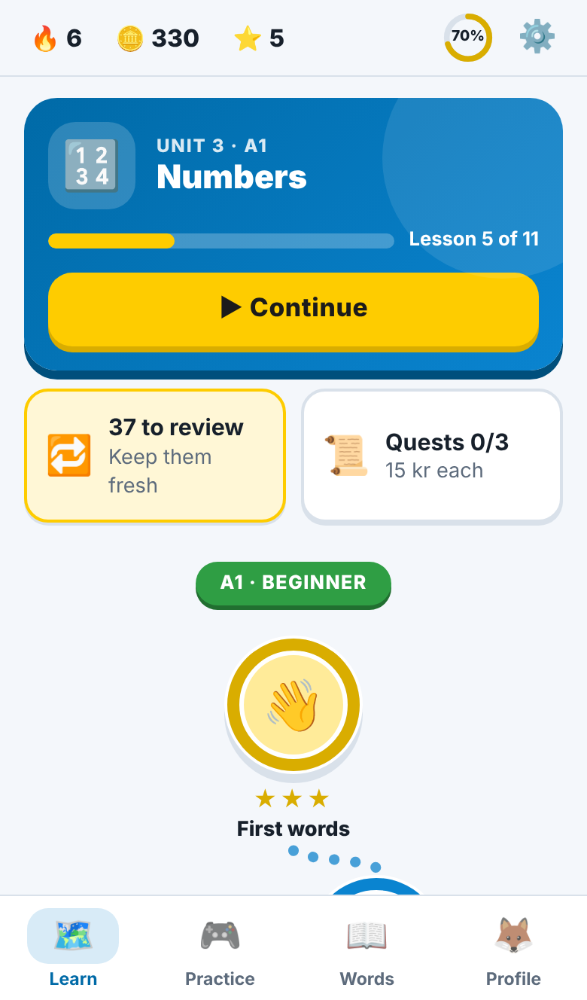
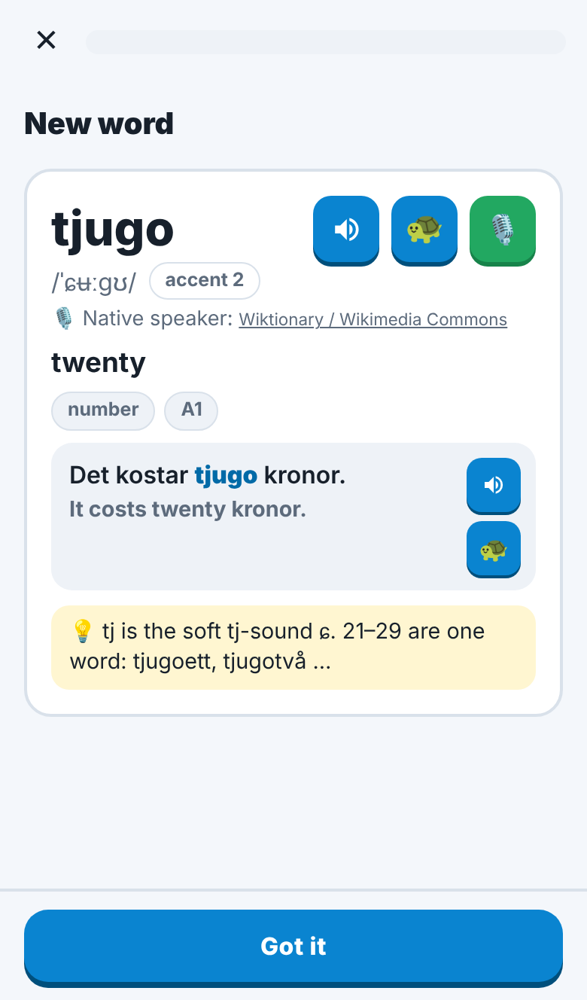
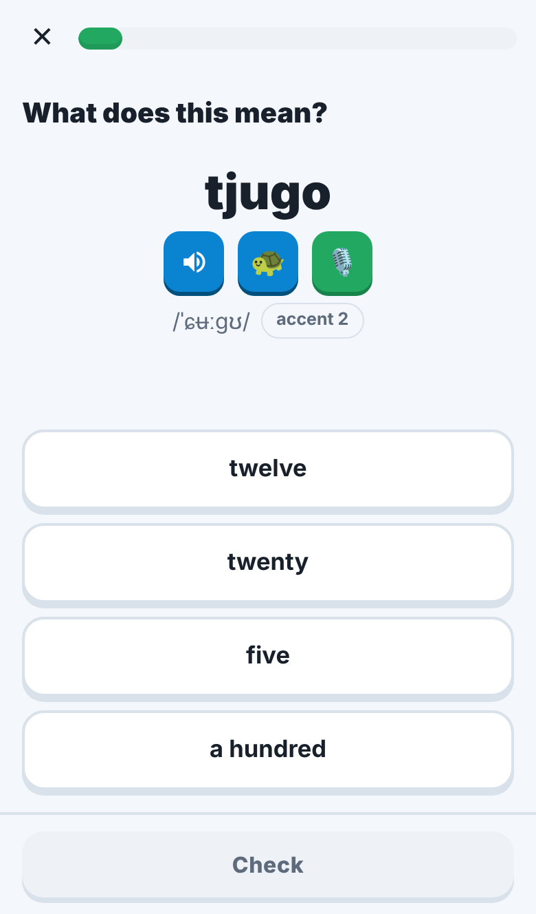
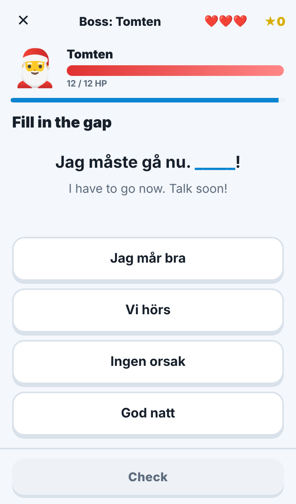
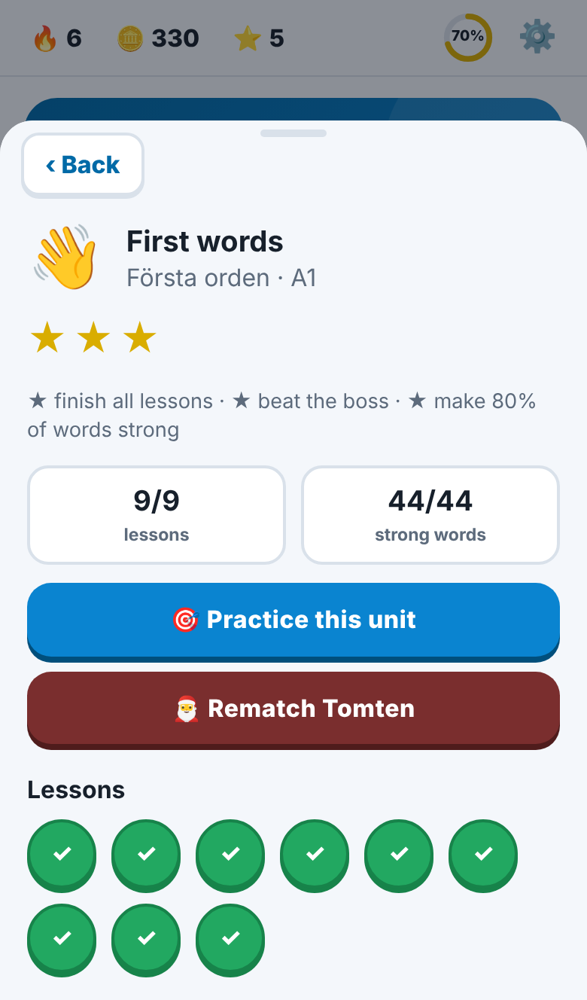
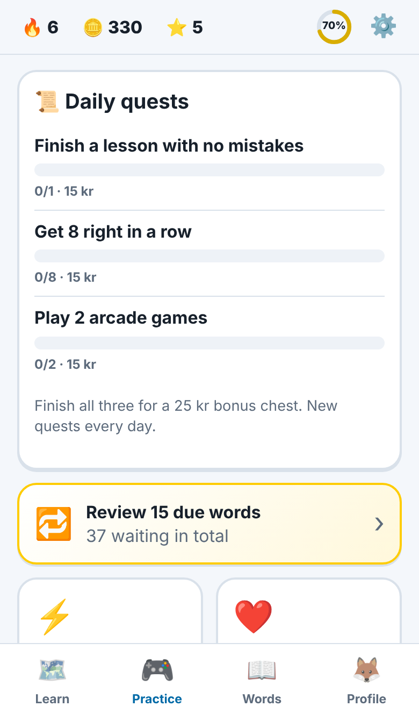
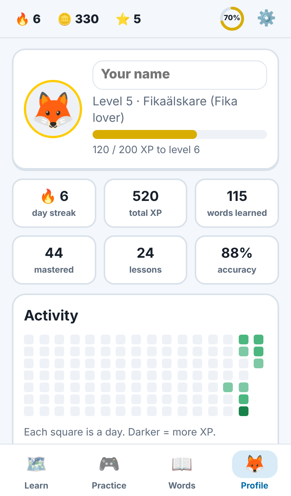

# 🇸🇪 Svenska Quest

**Learn Swedish words by playing: lessons, boss battles, streaks, quests and real pronunciation. Free, made for your phone, no account needed.**

### ▶️ Play now: **[miladmzdh.github.io/swedish_vocab](https://miladmzdh.github.io/swedish_vocab/)**

<p align="center">
  
  
  
  
</p>

- **1,869 words** in **35 themed units**, from your first *hej* to talking about society and the news (CEFR A1 → B1)
- Every word has its **en/ett gender**, **all its forms** (plural, past tense, comparative…), an **example sentence**, and its **pronunciation** written in IPA
- **Listen three ways**: your phone's Swedish voice 🔊, the same voice slowed down 🐢, and **real native speakers** 🎙️ when a recording exists
- **Spaced repetition** brings each word back right before you'd forget it
- Works **offline** and saves your progress automatically

---

## 📱 Get started in one minute

1. **Open the link** on your phone: <https://miladmzdh.github.io/swedish_vocab/>
2. **Add it to your home screen** so it works like a real app:
   - **iPhone (Safari):** tap the **Share** button (the square with an arrow) → **Add to Home Screen** → **Add**
   - **Android (Chrome):** tap the **⋮** menu → **Install app** (or **Add to Home screen**)
3. **Open it from the new icon** and tap the first circle, 👋 *First words*. Off you go!

> 💡 Use the home-screen icon, not a browser tab. On iPhone the two keep **separate** progress, and the icon version keeps its data safest.

---

## 🎮 How it works

### The learning path 🗺️
The **Learn** tab is a path of units, from easy to harder. Each unit has a few short **lessons** of 5 new words (about 3 minutes each) and ends with a **boss battle**.

<p align="center">
  
</p>

- **★ Stars:** ★ finish all lessons · ★★ beat the boss · ★★★ make 80% of the unit's words strong
- **Unlocking:** the next unit opens once you've done half of the current one. In a hurry? Tap a locked unit and take the **🦘 Jump here** test, or turn on **Free mode** in Settings to open everything.
- **Bosses** (🎅 Tomten, 🧌 Frågetrollet, 🐉 Räknedraken, 🐟 Surströmmingen, 🫎 Älgen…) have 12 HP. You have 3 hearts and 20 seconds per question. Typed answers hit twice as hard!

### Inside a lesson
New words come with a card showing the word, its pronunciation, its forms, an example sentence and a tip. Then come quick questions that get harder as you learn:

| | | |
|---|---|---|
| 🇸🇪→🇬🇧 What does it mean? | 🇬🇧→🇸🇪 Pick the Swedish word | 👂 What do you hear? |
| ⌨️ Type it (with **å ä ö** keys) | ⚖️ *en* or *ett*? | 🔤 Pick the right form (past tense, plural…) |
| 📝 Fill the gap in a sentence | 🧩 Spell it from letter tiles | 🃏 Match the pairs |
| ✍️ Dictation: type what you hear | 🎙️ Say it out loud (speech recognition) | |

Get something wrong and it comes back later in the lesson until you get it right. Small typos and missing accents count as correct, but you'll be shown the right spelling.

### Reviews 🔁
Words come back for review on a schedule (after a few hours, then 1 day, 3 days, a week, two weeks…). When some are due, a **"words to review"** card appears at the top of the Learn tab. Doing a few every day is the secret to remembering them.

### Practice & games 🎮
The **Practice** tab has **3 daily quests** (15 kr each, plus a 25 kr bonus for all three) and the arcade:

| Game | |
|---|---|
| ⚡ **Blitz** | 60 seconds, as many as you can. Combos give double and triple points. |
| ❤️ **Survival** | 3 lives, and it keeps getting harder |
| ⚖️ **Gender Rush** | *en* or *ett*? As fast as you can |
| 🧩 **Match Madness** | Match pairs against the clock |
| 🎧 **Listening Lab** | Train your ear |
| 🎙️ **Speaking** | Say words and get instant feedback |
| 🎯 **Weak words** | The words you miss most |

<p align="center">
  
  
</p>

### Rewards 🏆
**XP and levels** (from *Nybörjare* to *Legend*), a **daily goal** ring, **streaks** 🔥, **34 achievements**, and **kronor** 🪙 to spend in the shop on 🧊 streak freezes, avatars and color themes (Midsommar, Lucia, Fika, Norrsken).

### Words 📖
The **Words** tab is a dictionary of everything in the course. Search in Swedish or English, filter by *new / learning / mastered* or by unit, and tap any word to see its card. It also has the **🔊 Sound guide**, a short tour of how Swedish sounds: long and short vowels, the sj- and tj-sounds, silent letters, and the two pitch accents.

---

## 🔊 Pronunciation

Every word has three buttons:

| | |
|---|---|
| 🔊 | Your phone's Swedish voice |
| 🐢 | The same voice at half speed (example sentences have a 🐢 *Slowly* button too) |
| 🎙️ | A **native speaker** at their original speed, recorded by Swedes for [Wiktionary](https://en.wiktionary.org) and [Lingua Libre](https://lingualibre.org). It shows up whenever a recording of that word exists; the card names the source and the speaker. |

You'll also see the IPA pronunciation (like `/ˈɕʉːɡʊ/`) and whether the word has **accent 1** or **accent 2**, the "melody" that makes Swedish sound Swedish.

**Can't hear the phone voice?** Your phone needs a Swedish voice installed:
- **iPhone:** Settings → Accessibility → Spoken Content → Voices → **Swedish** → download *Alva*
- **Android:** Settings → System → Languages → Text-to-speech → Google → install **Swedish**

Then open the app again. You can test it and set the speed in ⚙️ **Settings → Sound**.

---

## 💾 Your progress

- **Saved automatically on your phone** after every answer. There's no account, and your progress is never sent anywhere (unless you turn on sync below).
- **Make a backup** now and then: ⚙️ **Settings → Your progress → Download backup file**, or **Copy backup code** and paste it into a note. Restore it the same way, and it merges with whatever is on the phone.
- ⚠️ **On iPhone, deleting the home-screen icon deletes its progress.** Back up first, or use sync (below).

### ☁️ Optional: sync with your own GitHub account
This keeps your progress in a **private gist** on *your* GitHub account, so it survives a new phone and syncs between devices.

1. On GitHub: profile picture → **Settings** → **Developer settings** → **Personal access tokens** → **Tokens (classic)** → **Generate new token (classic)**
2. Give it a name like `Svenska Quest`, pick an expiration, tick **only `gist`**, and click **Generate token**
3. Copy the token (it starts with `ghp_`) with the copy button
4. In the app: ⚙️ **Settings → Sync with GitHub** → paste the token → **Sync now**

After that it syncs automatically after every lesson. On another device, paste the same token and tap **Sync now**. The token stays on your phone and can only read and write gists.

---

## ❓ Questions

<details>
<summary><b>Do I need to reinstall when the app gets updated?</b></summary>

No. New words and improvements arrive by themselves. When a new version is ready you'll see **"✨ A new version is ready → Update"**. If something looks old, close the app completely and open it again.
</details>

<details>
<summary><b>I don't see the 🎙️ native speaker button</b></summary>

Not every word has a recording (phrases and sentences never do). Check that **Settings → Sound → Native-speaker recordings** is on, and tap **🎙️ Test** next to *Native recordings check*. It shows whether your phone can reach the recordings. You need an internet connection for these; everything else works offline.
</details>

<details>
<summary><b>The speaking exercise doesn't hear me</b></summary>

Allow microphone access when asked. In a quiet place, speak clearly right after tapping 🎤. If you can't talk right now, tap **"Can't speak now"**, or turn speaking off in Settings → Learning.
</details>

<details>
<summary><b>No sound effects on iPhone</b></summary>

Check the silent switch on the side of the phone, and the volume.
</details>

<details>
<summary><b>Is it really free? Does it track me?</b></summary>

Yes, it's free, there are no ads, and there is no tracking. Your progress lives only on your phone, or in your own gist if you turn on sync. The app only goes online to fetch native recordings from Wikimedia Commons and, if you enable it, to sync with your GitHub.
</details>

<details>
<summary><b>I found a mistake in a word</b></summary>

Please [open an issue](https://github.com/miladmzdh/swedish_vocab/issues) with the word and what's wrong.
</details>

---

## 📚 All 35 units

| Level | Units (number of words) |
|---|---|
| **A1** | 👋 First words (44) · 🙋 Me, you & questions (51) · 🔢 Numbers (52) · 📅 Days & time (60) · 👪 Family & people (51) · 🍎 Food & drink (59) · 🏠 At home (56) · 🏃 Everyday verbs (65) · 🎨 Colors & shapes (34) · 💪 The body (48) · 👕 Clothes (45) · 🏙️ In town (55) · 📏 Opposites (65) |
| **A2** | 🐾 Animals (54) · 🌦️ Weather & nature (59) · 🚆 Transport & travel (60) · 🛒 Shopping & money (47) · 💼 Work & jobs (56) · 🎓 School & study (50) · 🩺 Health & doctor (55) · ⚽ Hobbies & sports (55) · 🍳 Kitchen & cooking (50) · 😊 Feelings & personality (54) · 🗣️ Talking & thinking (67) · 🔗 Little words (68) · 🍽️ Restaurant & fika (49) |
| **B1** | 💻 Tech & internet (50) · 🔑 Housing & admin (50) · 🏛️ Society & news (56) · 🌲 Environment & outdoors (49) · 🇸🇪 Swedish culture (48) · 💭 Ideas & abstract words (58) · ✨ Describing things (55) · 💬 Everyday expressions (50) · 🎭 Arts, music & media (44) |

**How the words were made and checked:** each unit was written to a strict [style guide](tools/VOCAB_STYLE.md) aimed at standard Central Swedish. Every pronunciation was compared automatically with Wiktionary ([WikiPron](https://github.com/CUNY-CL/wikipron)) and [ipa-dict](https://github.com/open-dict-data/ipa-dict), and each unit then got an independent review of meanings, genders, every inflected form, example sentences and pronunciation. Words that share an English meaning (like *veta* and *känna*, both "to know") are labelled so the quizzes stay fair.

---

## 🛠️ For the curious: hosting & development

<details>
<summary><b>Host your own copy (GitHub Pages, free)</b></summary>

1. Fork or copy this repository (it has to be **public** on a free GitHub plan).
2. **Settings → Pages → Build and deployment → Deploy from a branch**, then pick `main` and `/ (root)` and **Save**.
3. After a minute it's live at `https://<your-username>.github.io/swedish_vocab/`.

There's no server and no build step: it's a plain static website (HTML, CSS and JavaScript modules) with an offline service worker.
</details>

<details>
<summary><b>Project layout and tools</b></summary>

```
index.html, css/, js/   the app (vanilla JavaScript modules, no framework)
sw.js                   offline service worker (bump VERSION after changing app files)
data/units.json         the 35 units, their bosses and scopes
vocab/<unit>.json       the vocabulary, one file per unit (the source of truth)
data/vocab.json         all units merged (generated by tools/build-vocab.mjs)
tools/                  validation, reference lookups, merging, screenshots
tests/                  unit tests and phone-sized browser tests (Playwright)
```

- Run locally: `npx http-server .` and open <http://localhost:8080>
- `tools/fetch-refs.sh` downloads the reference pronunciation data and word frequencies (not committed)
- `node tools/validate.mjs vocab/food.json` checks a unit against [the style guide](tools/VOCAB_STYLE.md) and compares every IPA with the references
- `node tools/lookup.mjs hund katt` shows the reference pronunciations and frequency of words
- `node tools/build-vocab.mjs --report` merges all units into `data/vocab.json` and lists overlaps
- `node --test tests/*.test.mjs` runs the unit tests
- `node tests/smoke.mjs http://localhost:8080/` plays a whole lesson and the arcade games in a phone-sized browser; `tests/navigation.mjs` checks the back buttons and the phone back gesture; `tests/sync.mjs` and `tests/native.mjs` test gist sync and native recordings against mocked APIs
- `node tools/screenshots.mjs` regenerates the screenshots in this README

Word progress is stored per word id (`<word>.<part-of-speech>`), so you can edit translations, examples or pronunciations without anyone losing progress.
</details>

## 🙏 Credits

Pronunciations were cross-checked against [WikiPron](https://github.com/CUNY-CL/wikipron) (Wiktionary data, CC BY-SA) and [ipa-dict](https://github.com/open-dict-data/ipa-dict). Word frequencies come from [FrequencyWords](https://github.com/hermitdave/FrequencyWords). Native-speaker recordings stream from [Wikimedia Commons](https://commons.wikimedia.org) ([Wiktionary](https://en.wiktionary.org) and [Lingua Libre](https://lingualibre.org) contributors, CC BY-SA), and each speaker is credited in the app.

*Lycka till och ha kul! 🇸🇪*
